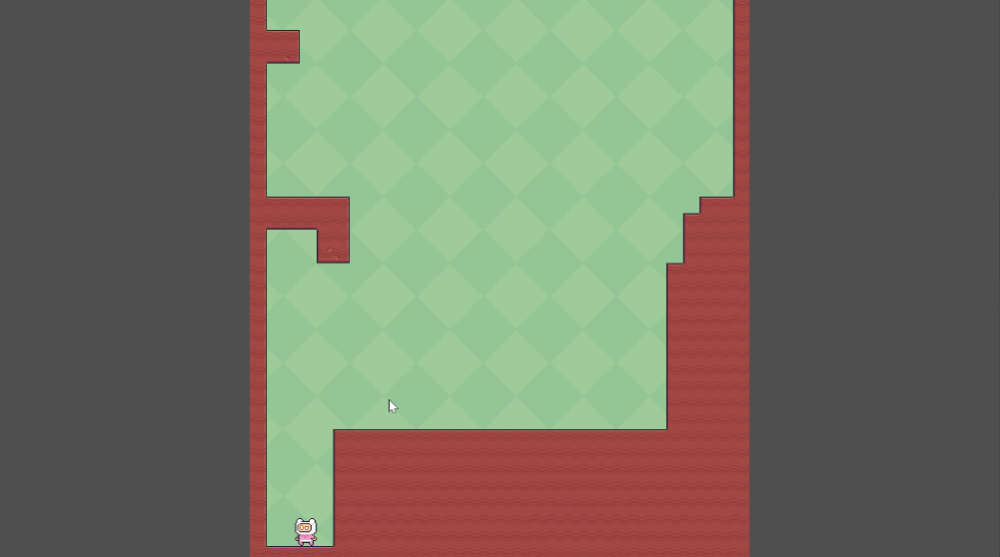
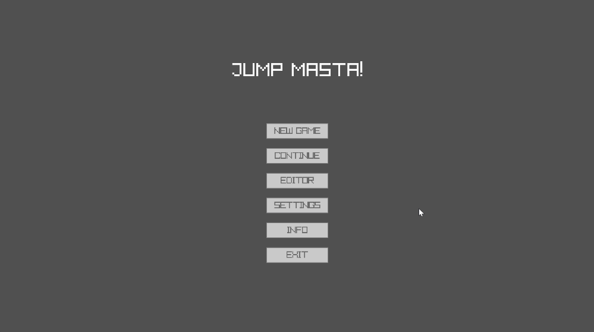

# Jump Masta

[](https://github.com/kanvvu/jump-masta/actions/workflows/ci.yml)

> **Play in Browser:** [kanvvu.github.io/jump-masta](https://kanvvu.github.io/jump-masta/)

A 2D precision platformer built in C++17 and Raylib, compiled to both native desktop and WebAssembly. Heavily inspired by [Jump King](https://store.steampowered.com/app/1061090/Jump_King/).



### Level Editor



---

## Why This Project Exists

Built as a focused C++ programming project to practice **RAII**, **OOP**, **STL**, and **CMake**.

---

## Key Features

- **Drag Jump Mechanic:** To play, you only need a mouse
- **Interconnected Levels:** You can access levels not only vertically but also horizontally
- **Built-in Level Editor (Prototype):** An easy way to create new levels
- **WebAssembly Support:** Playable directly in the browser

---

## C++ Architecture & Stack

| Component | Implementation Details |
| :--- | :--- |
| **Language & Build** | C++17, CMake (3.24+), Raylib (6.0), RayGui |
| **RAII Lifetimes** | `RaylibContext` scopes window/audio init and shutdown; non-copyable `Assets` owns GPU textures, animations, and loaded sounds |
| **Scene Management** | Polymorphic `IScene` interface (`MenuScene`, `GameScene`, `LevelEditor`) owned via `std::unique_ptr` inside `Game` |
| **Physics & Collision** | Sub-stepped `dt` integration and tile collision resolution |
| **Testing & CI/CD** | CTest suite, GitHub Actions, Emscripten WASM build, and automatic deployment to GitHub Pages |

---

## Controls

### Gameplay
| Input | Action |
| :--- | :--- |
| **Hold & Drag Left Mouse** | Aim direction & charge jump power |
| **`R`** | Restart run from the beginning |
| **`ESC`** | Save current run state and return to Main Menu |

### Level Editor
| Input | Action |
| :--- | :--- |
| **Left Click / Drag (on canvas)** | Paint or erase selected tile(s) |
| **Drag Box (on sprite palette)** | Select a single tile or multi-tile brush |
| **Mouse Wheel (on sprite palette)** | Scroll sprite palette |
| **Right Mouse Drag** | Pan the editor camera |
| **`E`** / **`ESC`** | Switch to Game / Return to Main Menu |

---

## How to Build

### Desktop (Windows / Linux)

> **Linux prerequisites (Ubuntu/Debian):** Raylib's GLFW backend requires X11 and OpenGL dev headers:
> ```bash
> sudo apt-get update && sudo apt-get install -y libx11-dev libxrandr-dev libxinerama-dev libxcursor-dev libxi-dev libgl1-mesa-dev
> ```

Configure, build, and run tests (`CMake` will download Raylib `6.0` automatically if `RAYLIB_DIR` is not set):

```bash
cmake -B build
cmake --build build
ctest --test-dir build --output-on-failure
```

- Run the game binary from `build/jump-masta/` (e.g. `./build/jump-masta/jump-masta` or `build\jump-masta\Debug\jump-masta.exe`).
- Pass `-DDEV_MODE=ON` when configuring if you want editor saves to write directly into `src/resources/`.

### Web (Emscripten)

With the [Emscripten SDK](https://emscripten.org/docs/getting_started/downloads.html) activated in your terminal:

```bash
emcmake cmake -B build-web -DPLATFORM=Web
cmake --build build-web --target jump-masta
```

Outputs `jump-masta.html`, `jump-masta.js`, `jump-masta.wasm`, and `jump-masta.data` into `build-web/jump-masta/`. Serve that directory over local HTTP (e.g., `python -m http.server`) to test in the browser.

---

## Future Improvements

- Add GoogleTest
- Better test coverage
- More content:
  - NPCs
  - Quests
  - Dialog system
  - Mini-games